**Infrastructure and Cloud Computing (ICN) · 2026/2027 · Theme B: DevOps and CI/CD**

Group G7 · Samuel Silva (202200315)

| | |
|---|---|
| Duration | ~60 minutes |
| Cost | ~1 cent of Azure for Students credit (VM runs < 1 hour) |
| Platform | Microsoft Azure (Azure for Students), GitHub |
| Works on | Any OS with a browser (Windows, macOS, Linux) |

In Lab 3 you created a virtual machine by clicking through the Azure portal. In this lab you create the same kind of VM **from code**, configure it **automatically**, and redeploy it **on every git push**, through a pipeline that waits for your approval before touching Azure.

```
 You            GitHub                          Azure
 ───            ──────                          ─────
 edit page ──push──► fork ──► GitHub Actions
                              1. Terraform  ──► network, firewall, IP, Linux VM
                              2. Ansible    ──► nginx + web page on the VM
                              3. Smoke test ──► page shows the new version
```

---

## 1. Objective

By the end of this lab you will be able to:

1. **Provision** cloud infrastructure declaratively with Terraform (Infrastructure as Code).
2. **Configure** a server with Ansible (configuration management) and explain how it differs from provisioning.
3. **Operate** a CI/CD pipeline in GitHub Actions: CI on pull requests, Continuous Delivery with a manual approval gate.
4. **Authenticate** a pipeline to Azure without passwords (OIDC / workload identity federation) and store secrets correctly.
5. **Explain** Terraform state, idempotency and why infrastructure should be destroyed through the same tool that created it.

## 2. Prerequisites

| Requirement | Check |
|---|---|
| Azure for Students subscription, active, with your role = **Owner** | Portal → Subscriptions → Azure for Students → Overview → *My role* |
| GitHub account | github.com |
| A browser | Everything is done in the Azure portal, Azure Cloud Shell and GitHub |
| Lab 3 completed | You know the portal, resource groups and what a VM needs |

No local installation is needed. Terraform and Ansible run on GitHub's servers.

**Values you will collect.** Write them down as you go; you need them in Part C.

| Placeholder | Example from the reference run | Where you get it |
|---|---|---|
| `<github-username>` | `2310Samuelsilva` | Your GitHub profile |
| `<student-number>` | `202200315` | Your student number |
| `<owner-id>` | `164482481` | Step A4 |
| `<repo-id>` | `1453252416` | Step A4 (your fork has its own ID) |
| `<client-id>` | `38152e2e-…` | Step B2 |
| `<tenant-id>` | `ad28c625-…` | Step B2 |
| `<subscription-id>` | `fea75faf-…` | Step C1 |
| `<storage-account>` | `icntfstate202200315` | Step B1 |

## 3. Task

Six parts. Times are indicative.

| Part | What | Time |
|---|---|---|
| A | Fork the repository, enable Actions, create an SSH key | 10 min |
| B | Azure: state storage, pipeline identity, permissions | 20 min |
| C | GitHub: variables, secret, approval environment | 10 min |
| D | Run the pipeline: pull request → approve → live → idempotent rerun | 10 min |
| E | Hands-on: change the infrastructure | 5 min |
| F | Clean up | 5 min |

### Part A – Prepare

**A1. Fork the repository.** Open `https://github.com/2310Samuelsilva/icn-projeto-devops` → **Fork** → keep the name → **Create fork**.

**A2. Enable Actions on your fork.** GitHub disables workflows on forks by default. In your fork: **Actions** tab → **I understand my workflows, go ahead and enable them**.

> Do not commit anything to `main` until Part C is finished: a push to `main` starts the deployment pipeline.

**A3. Create the SSH key pair Ansible will use.** In the Azure portal, open **Cloud Shell** (the `>_` icon in the top bar) → **Bash**, and run:

```bash
ssh-keygen -t rsa -b 4096 -N "" -C "icn-devops-demo" -f ~/.ssh/icn-devops
```

This creates `~/.ssh/icn-devops` (private key) and `~/.ssh/icn-devops.pub` (public key). Keep Cloud Shell open; you copy both in Part C.

> Never screenshot, share or commit the private key.

**A4. Find your GitHub owner ID and repository ID.** Azure needs these numbers to trust your repository. Open in the browser and note the `"id"` field of each:

- `https://api.github.com/users/<github-username>` → `<owner-id>`
- `https://api.github.com/repos/<github-username>/icn-projeto-devops` → `<repo-id>`

### Part B – Azure: storage, identity, permissions

**B1. Storage for the Terraform state.** Terraform records what it has built in a *state file*. The pipeline runs on a fresh machine every time, so the state must live somewhere permanent: an Azure Storage account.

Portal → **Storage accounts** → **+ Create**:

| Field | Value |
|---|---|
| Resource group | **Create new** → `icn-devops-tfstate-rg` |
| Storage account name | `icntfstate<student-number>` (lowercase letters and digits, globally unique) → this is `<storage-account>` |
| Region | **Austria East** |
| Primary service | Azure Blob Storage or Azure Data Lake Storage |
| Performance | Standard |
| Redundancy | Locally-redundant storage (LRS) |

Leave the other tabs on their defaults → **Review + create** → **Create**.

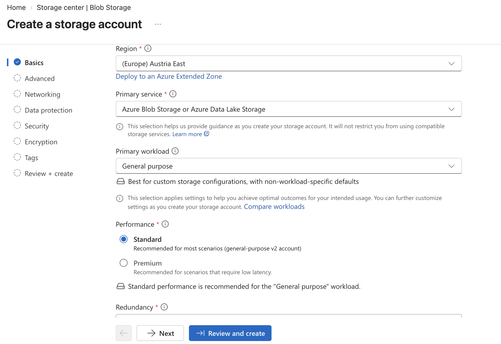

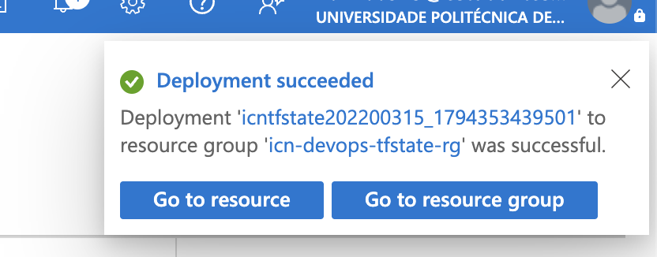

**Go to resource** → **Data storage → Containers** → **+ Add container** → Name `tfstate`, access level **Private** → **Create**.

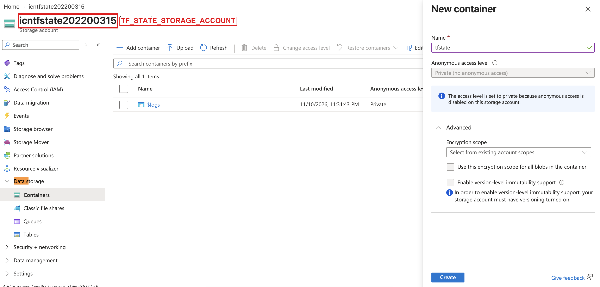

**B2. App registration: the pipeline's identity.** The pipeline needs its own identity in Azure (it cannot use your login). Portal → **Microsoft Entra ID** → **Add** → **App registration**.

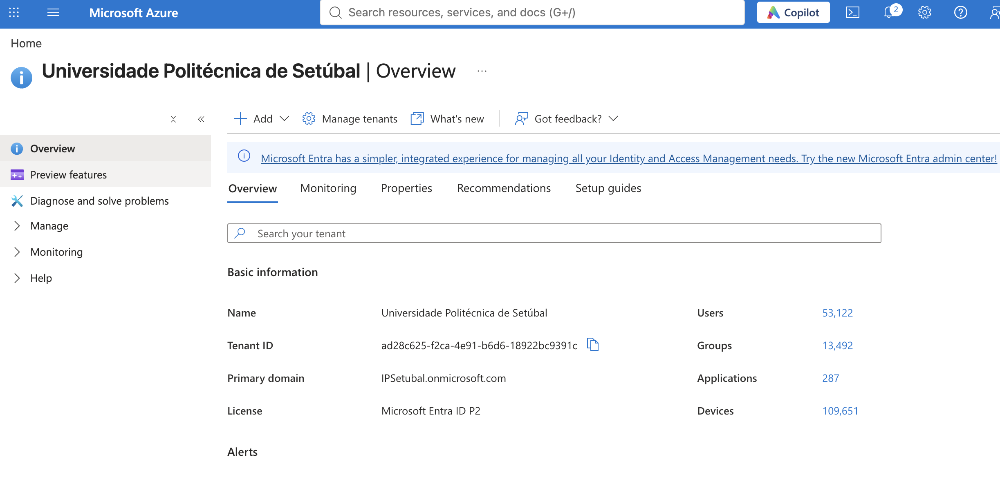

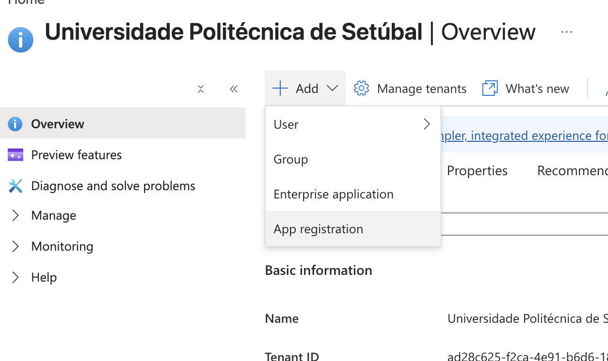

| Field | Value |
|---|---|
| Name | `icn-devops-github-<student-number>` |
| Supported account types | Accounts in this organizational directory only (Single tenant) |
| Redirect URI | leave empty |

> All students share the university directory. The student number in the name lets you find **your** app in step B4.

**Register**. On the Overview page, note **Application (client) ID** → `<client-id>` and **Directory (tenant) ID** → `<tenant-id>`.

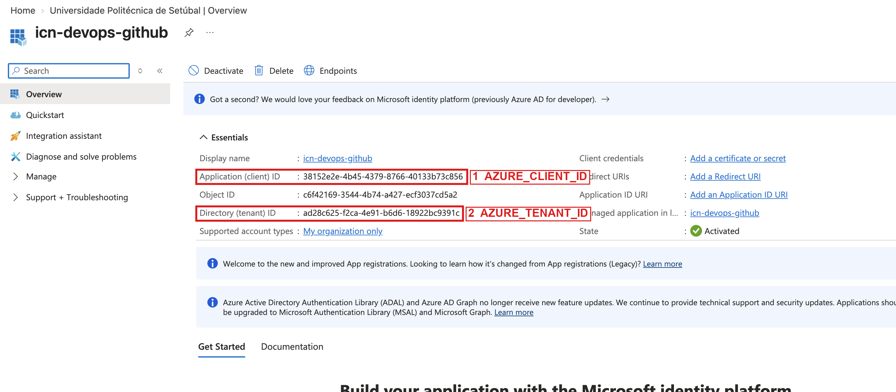

**B3. Federated credentials: trust GitHub, no password.** A federated credential tells Azure: *"accept login tokens issued by GitHub, but only from this repository, in this situation"*. No secret is created or stored.

In your app: **Manage → Certificates & secrets** → **Federated credentials** → **+ Add credential** → scenario **GitHub Actions deploying Azure resources**.

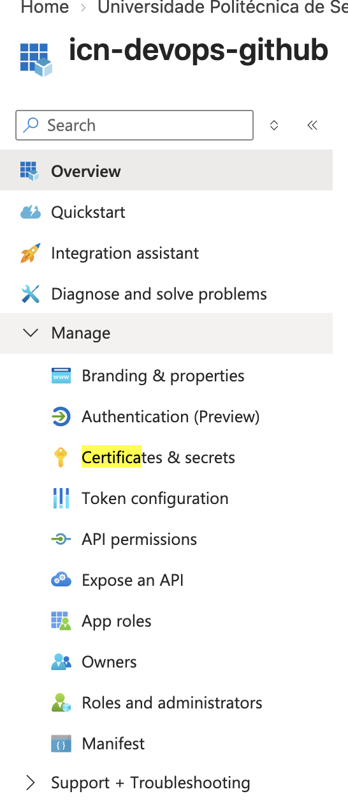

Add **three** credentials, all with Organization `<github-username>`, Organization ID `<owner-id>`, Repository `icn-projeto-devops`, Repository ID `<repo-id>`:

| Name | Entity type | Value | Used by |
|---|---|---|---|
| `github-main` | Branch | `main` | Jobs on `main` without an environment (CD plan) |
| `github-pr` | Pull request | – | CI on pull requests |
| `github-production` | Environment | `production` | Deploy and destroy jobs (behind the approval gate) |

Leave the generated *Subject identifier* unchanged.

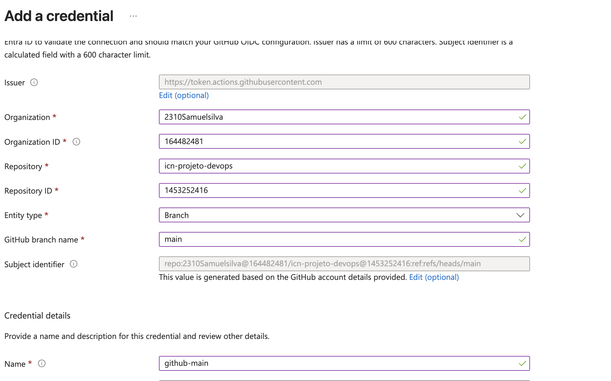

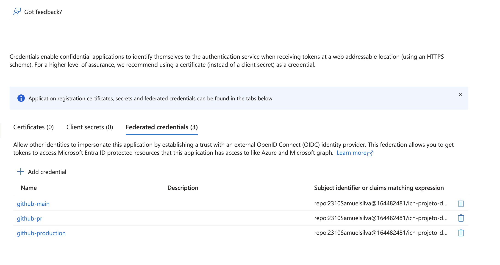

**B4. Give the identity permission on your subscription.** The app can now log in, but it may do nothing yet. Portal → **Subscriptions** → **Azure for Students** → **Access control (IAM)** → **Add** → **Add role assignment**.

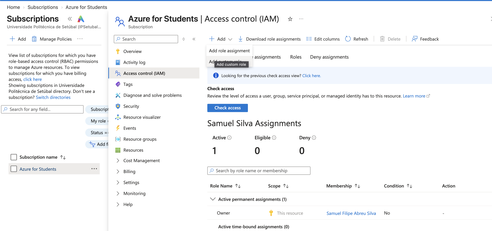

- **Role:** tab **Privileged administrator roles** → **Contributor** (create and delete resources; cannot grant access to others) → Next.

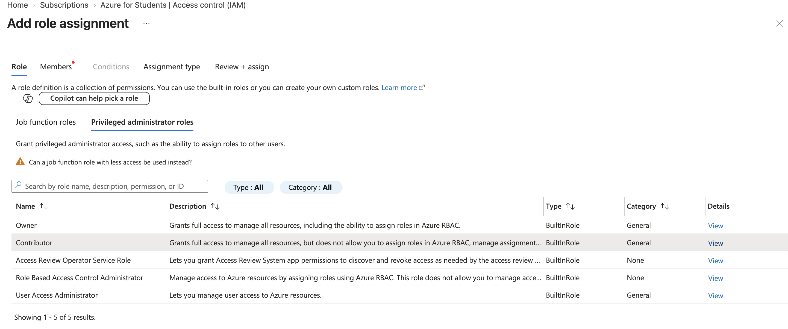

- **Members:** *User, group, or service principal* → **Select members** → search `icn-devops-github-<student-number>` → select → Next.

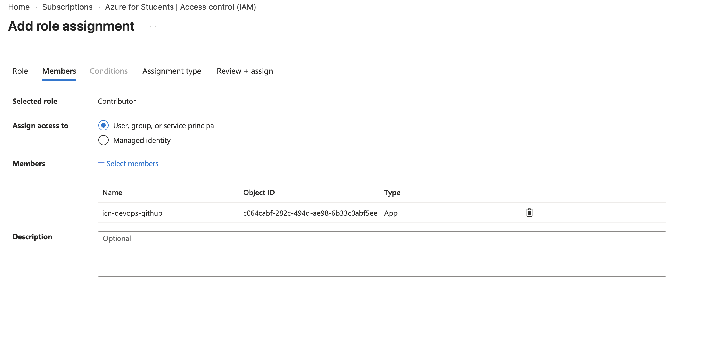

- **Review + assign**. The scope is your subscription.

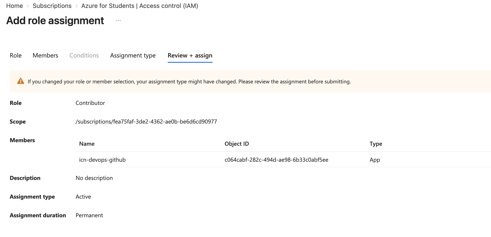

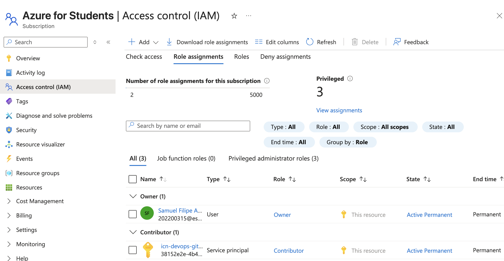

### Part C – GitHub: configuration and approval gate

**C1. Variables and secret.** Your fork → **Settings** → **Secrets and variables** → **Actions**.

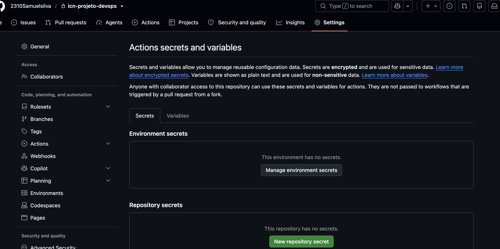

Find `<subscription-id>`: Portal → Subscriptions → Azure for Students → Overview.

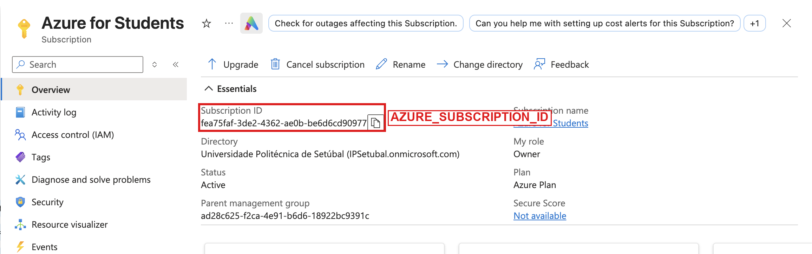

**Variables** tab → **New repository variable**, five times. Variables are plain text; these are identifiers, not passwords.

| Name | Value |
|---|---|
| `AZURE_CLIENT_ID` | `<client-id>` |
| `AZURE_TENANT_ID` | `<tenant-id>` |
| `AZURE_SUBSCRIPTION_ID` | `<subscription-id>` |
| `TF_STATE_STORAGE_ACCOUNT` | `<storage-account>` |
| `SSH_PUBLIC_KEY` | output of `cat ~/.ssh/icn-devops.pub` in Cloud Shell |

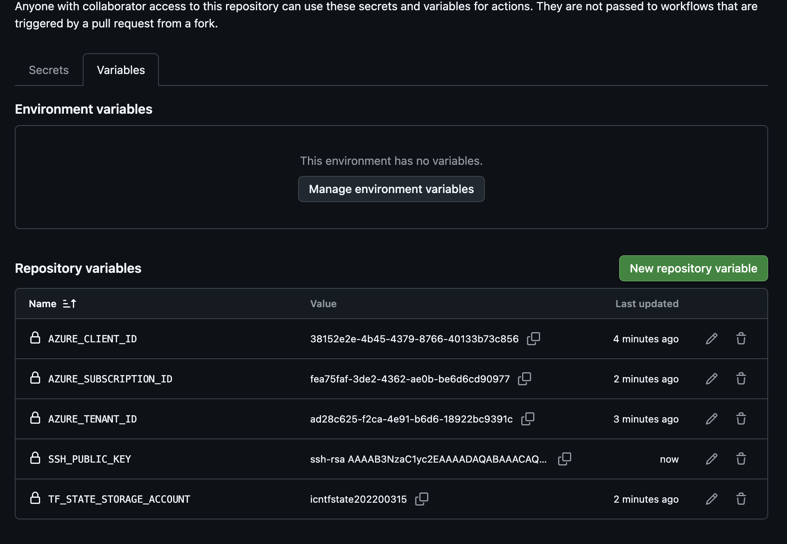

**Secrets** tab → **New repository secret**. Secrets are encrypted and masked in logs.

| Name | Value |
|---|---|
| `SSH_PRIVATE_KEY` | output of `cat ~/.ssh/icn-devops`, including the `-----BEGIN` and `-----END` lines |

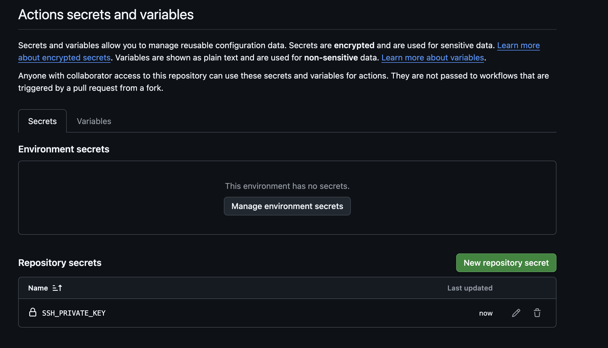

**C2. The `production` environment (approval gate).** **Settings** → **Environments** → **New environment** → `production` → **Configure environment**:

- Tick **Required reviewers** → add yourself.
- Leave **Prevent self-review** unticked (otherwise you cannot approve your own runs).
- **Save protection rules**.

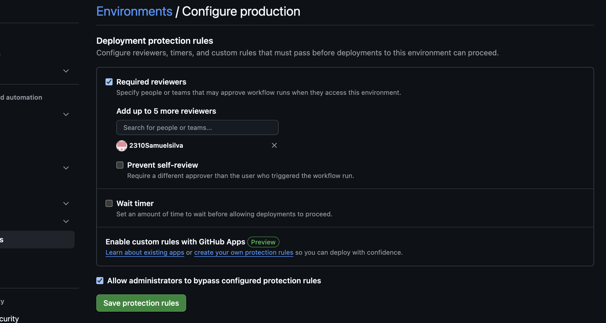

Any job that declares `environment: production` now pauses until you approve it.

### Part D – Run the pipeline

**D1. Open a pull request (CI).** In your fork open `app/index.html` → pencil icon → change the version text inside `<p id="version">…</p>` (e.g. to your student number) → **Commit changes** → choose **Create a new branch for this commit and start a pull request** → **Propose changes** → **Create pull request**.

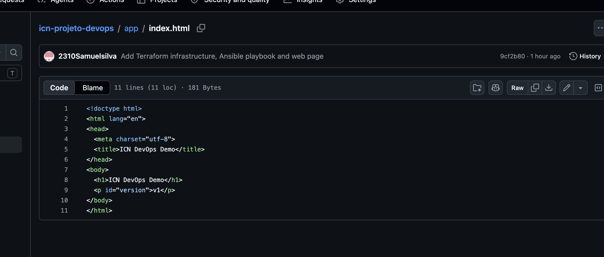

The **CI** workflow starts. Open it from the pull request and read the **Terraform plan** step. Expected: `Plan: 8 to add, 0 to change, 0 to destroy.` Nothing is created by CI.

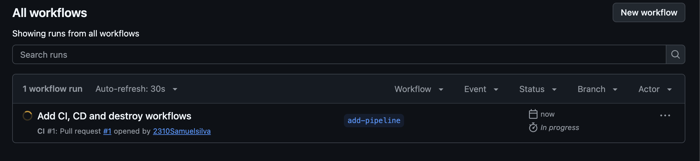

**D2. Merge and deploy (CD).** **Merge pull request** → **Confirm merge**. Go to **Actions** → the new **CD** run:

1. Job **plan** shows what will be created.
2. Job **deploy** stops: *"production waiting for review"*.

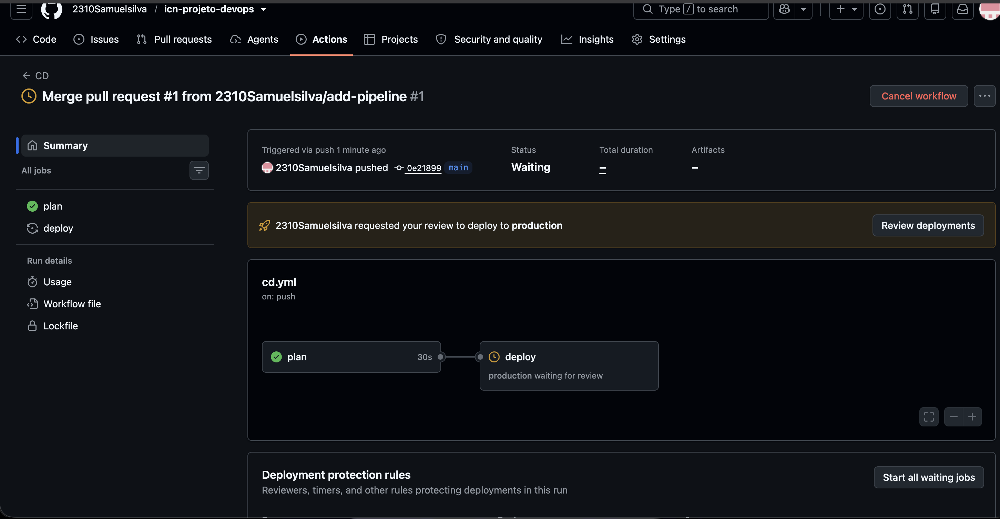

3. **Review deployments** → tick **production** → **Approve and deploy**.
4. Deploy runs for 3–5 min: Terraform apply → inventory → Ansible → smoke test.

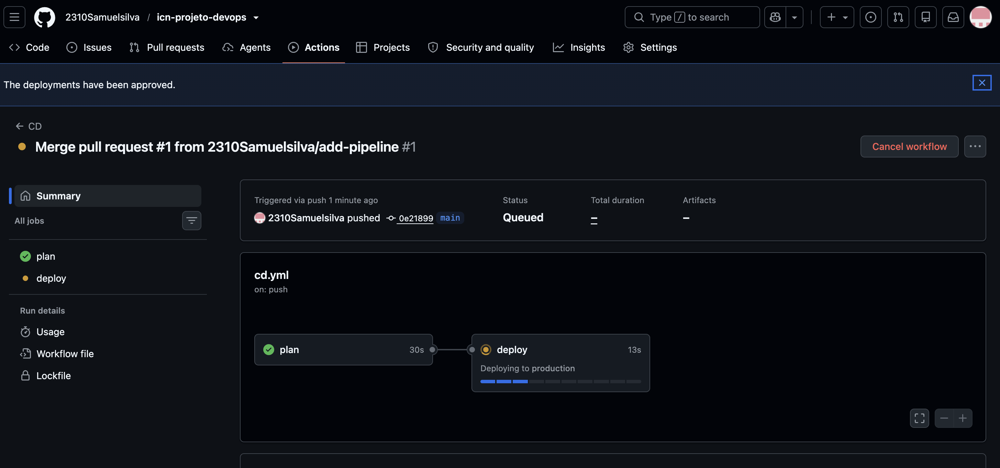

The **Smoke test** step ends with `Live at http://<ip> with version <your-text>`. Open that address.

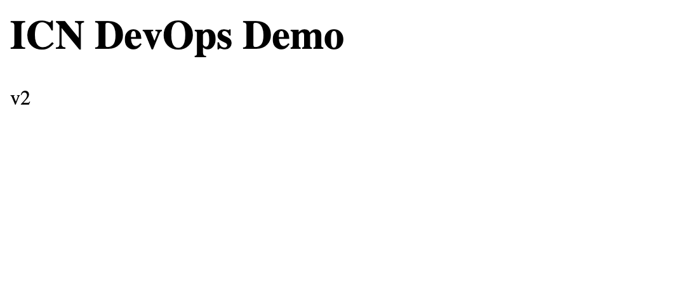

**D3. Run it again with no changes (idempotency).** **Actions** → **CD** → **Run workflow** → **Run workflow** → approve. Expected: plan *"No changes. Your infrastructure matches the configuration."*, apply `0 added, 0 changed, 0 destroyed`, Ansible `changed=0`.

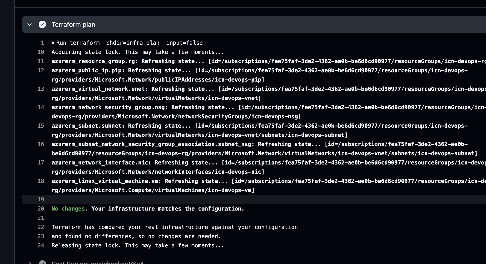

### Part E – Hands-on: change the infrastructure

Open port **8080** in the firewall, through a pull request.

1. Open `infra/main.tf` → pencil icon. Inside `azurerm_network_security_group.nsg`, after the `HTTP` rule, add:

   ```hcl
     security_rule {
       name                       = "Alt-HTTP"
       priority                   = 120
       direction                  = "Inbound"
       access                     = "Allow"
       protocol                   = "Tcp"
       source_port_range          = "*"
       destination_port_range     = "8080"
       source_address_prefix      = "*"
       destination_address_prefix = "*"
     }
   ```

2. Commit to a **new branch** and open a pull request. Read the CI plan: which resource changes, and is it *updated in-place* (`~`) or *replaced* (`-/+`)?
3. Merge, approve, and check in the portal: `icn-devops-rg` → `icn-devops-nsg` → **Inbound security rules** shows `Alt-HTTP`.

### Part F – Clean up

**F1. Destroy through the pipeline.** **Actions** → **Destroy** → **Run workflow** → approve.

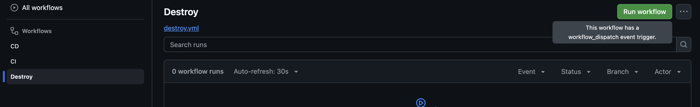

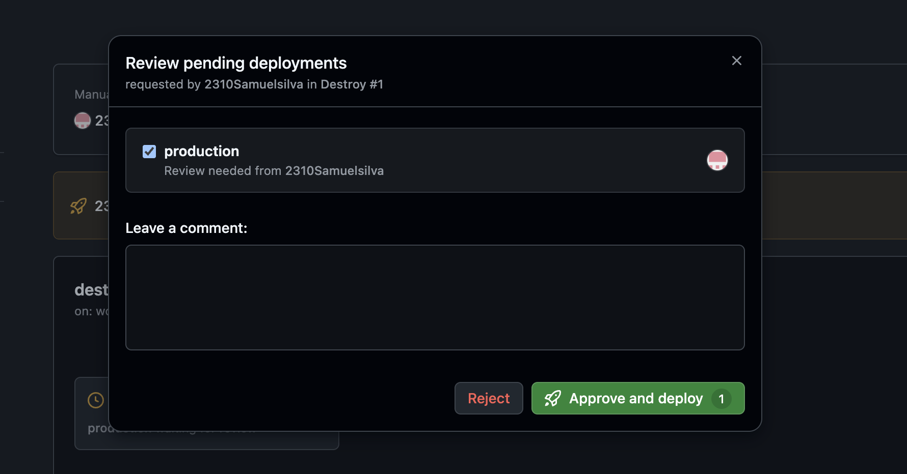

Expected: `Destroy complete! Resources: 8 destroyed.` The resource group `icn-devops-rg` disappears.

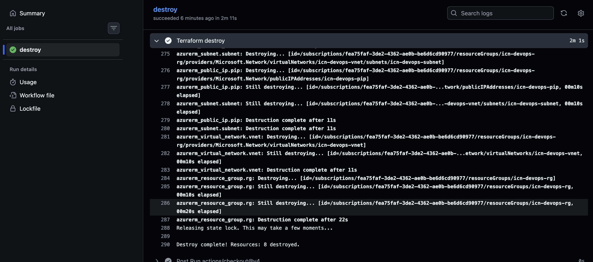

**F2. Optional full cleanup** (if you will not use the lab again): delete the resource group `icn-devops-tfstate-rg` and the app registration `icn-devops-github-<student-number>`.

> Always destroy through Terraform, not by deleting the resource group in the portal: otherwise the state file still lists resources that no longer exist.

## 4. Data and resources

**Repository:** `https://github.com/2310Samuelsilva/icn-projeto-devops`

| Path | Content |
|---|---|
| `infra/` | Terraform: provider, backend (remote state), variables, the 8 resources, outputs |
| `ansible/` | Playbook (wait for VM, install nginx, deploy page) and `ansible.cfg` |
| `app/index.html` | The web page; `<p id="version">` is checked by the smoke test |
| `.github/workflows/ci.yml` | On pull request: format check, validate, Ansible syntax check, plan |
| `.github/workflows/cd.yml` | On push to `main`: plan → approval → apply → Ansible → smoke test |
| `.github/workflows/destroy.yml` | Manual: approval → destroy |

**Resources created by Terraform** (resource group `icn-devops-rg`, region Austria East):

| Resource | Name | Configuration |
|---|---|---|
| Resource group | `icn-devops-rg` | Container for everything below |
| Virtual network + subnet | `icn-devops-vnet`, `icn-devops-subnet` | 10.0.0.0/16, 10.0.1.0/24 |
| Network security group | `icn-devops-nsg` | Inbound allow TCP 22 (Ansible) and 80 (HTTP); everything else denied |
| Public IP | `icn-devops-pip` | Standard SKU, static |
| Network interface | `icn-devops-nic` | Connects VM, subnet and public IP |
| Virtual machine | `icn-devops-vm` | **Standard_B2ats_v2**: 2 vCPU (AMD), 1 GiB RAM; Ubuntu Server 24.04 LTS; SSH key only |
| OS disk | created with the VM | Standard HDD (LRS) |

**Why this VM size.** Azure for Students only allows deployments in Norway East, Spain Central, Austria East, France Central and Germany West Central (subscription policy *Allowed resource deployment regions*). The classic free-tier size B1s is not available to the subscription in any of them. Among the sizes available, the cheapest Linux pay-as-you-go option was Standard_B2ats_v2 in Austria East at **USD 0.0108/hour** (Azure Retail Prices API, 9 Nov 2026). 1 GiB RAM is enough for nginx serving a static page.

**Cost of one lab run** (VM up < 1 hour): VM ≈ USD 0.01, plus public IP, disk and state storage (a few cents per month). Measured cost of the reference run: *TODO (Cost Management)*.

**Ways to minimise credit use:** destroy after each session (F1); do not pin an availability zone; LRS storage; smallest available VM size.

## 5. Expected result

- CI on a pull request shows a plan and creates nothing.
- Merging starts CD, which **waits for your approval** before changing Azure.
- After approval the page is reachable at the VM's public IP and shows your text; the smoke test confirms it.
- A rerun with no changes reports *No changes* and `changed=0`.
- The port-8080 change appears as a single in-place update to the NSG.
- After **Destroy**, `icn-devops-rg` no longer exists; `icn-devops-tfstate-rg` remains.

## 6. Analysis questions

1. Lab 3 created a VM in the portal with one wizard. Which of the 8 Terraform resources did the wizard create for you silently? What is gained by declaring them explicitly?
2. Terraform is *declarative*; Ansible runs *tasks in order*. Using this lab, explain the difference between **provisioning** and **configuration management**.
3. In D3 nothing changed. Which mechanism lets Terraform decide that, and why does Ansible also report `changed=0`?
4. Why is the Terraform state stored in Azure Storage and not in the Git repository? What would happen if two pipelines applied at the same time?
5. Is this pipeline **Continuous Delivery** or **Continuous Deployment**? What single setting would switch it to the other?
6. `AZURE_CLIENT_ID` is a *variable* but `SSH_PRIVATE_KEY` is a *secret*. Why is it safe to leave the client ID visible? What actually proves the pipeline's identity to Azure?
7. The NSG allows SSH (22) from any IP address. Why was that necessary here, which risk does it create, and how could it be reduced?
8. Why does the destroy workflow also require approval? Why should you not delete `icn-devops-rg` directly in the portal?
9. Name the AWS and Google Cloud equivalents of: Terraform state in Azure Storage, the app registration with federated credentials, and Azure Bicep.

## 7. Completion criteria

You have completed the lab when you can show:

- [ ] A pull request whose CI run shows a Terraform plan
- [ ] A CD run that waited for approval and then passed the smoke test
- [ ] The web page in your browser with your text
- [ ] A rerun with *No changes* and Ansible `changed=0`
- [ ] The CI plan for port 8080 showing one in-place change
- [ ] A Destroy run ending in `8 destroyed`
- [ ] Written answers to the analysis questions

## 8. Troubleshooting

| Symptom | Cause | Fix |
|---|---|---|
| Workflows never start on your fork | Actions disabled on forks | Step A2 |
| `AADSTS700213` / *No matching federated identity record found* | Federated credential does not match the token | Check owner/repo names and IDs (A4, B3). The error shows the subject GitHub sent; compare it with the credential |
| `AuthorizationFailed` | Role missing or given to another app | Step B4: role assignment for **your** app |
| `RequestDisallowedByPolicy` or `SkuNotAvailable` | Region or size not allowed for your subscription | Change `location` / `vm_size` defaults in `infra/variables.tf` |
| Storage account name already taken | Names are global | Choose another name; update `TF_STATE_STORAGE_ACCOUNT` |
| Ansible: `Permission denied (publickey)` | Keys in C1 do not match | Paste both keys again from the same pair |
| *Error acquiring the state lock* | A cancelled run left the lock | Wait a minute and rerun; or break the lease on `demo.tfstate` in the `tfstate` container |

## 9. References

- HashiCorp. *Terraform – azurerm backend*. developer.hashicorp.com/terraform/language/backend/azurerm
- HashiCorp. *Terraform AzureRM provider documentation*. registry.terraform.io/providers/hashicorp/azurerm
- Microsoft. *Workload identity federation*. learn.microsoft.com/entra/workload-id/workload-identity-federation
- GitHub. *Configuring OpenID Connect in Azure*. docs.github.com (Actions → Security hardening → OpenID Connect)
- GitHub. *Managing environments for deployment*. docs.github.com (Actions → Deployment → Environments)
- Ansible. *Ansible documentation*. docs.ansible.com
- G. Pestana. *ICN Laboratory 3 – Introduction to Microsoft Azure | VM & SQL Database*, 2026.

## 10. GenAI disclosure

*TODO: to be completed by the author (format from Lab 02).*
